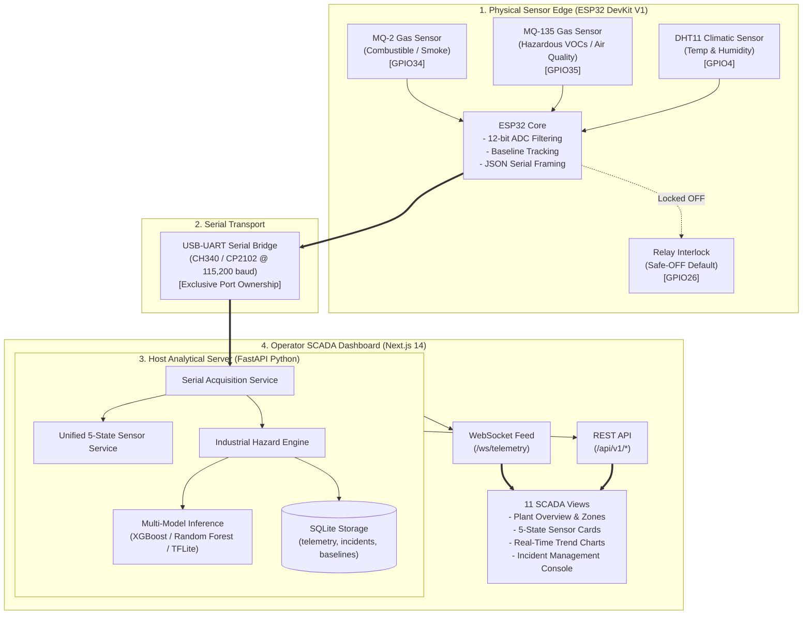

# HazardWatch

**Industrial Gas Monitoring, Edge Intelligence & SCADA Platform**

[](https://github.com/aashishniranjanb/HazardWatch/actions/workflows/ci.yml)
[](LICENSE)
[](https://www.python.org/)
[](https://nodejs.org/)
[](https://nextjs.org/)
[](https://fastapi.tiangolo.com/)
[](https://www.espressif.com/)

HazardWatch is an end-to-end industrial gas-response monitoring and edge intelligence solution. It pairs an **ESP32 microcontroller** streaming multi-channel gas and climatic data over an exclusive USB-UART link, an analytical **FastAPI backend** managing database persistence and multi-model inference, and a real-time **Next.js 14 SCADA dashboard** with 11 specialized plant monitoring views.

---

## Table of Contents

- [Overview & Problem Statement](#overview--problem-statement)
- [System Architecture](#system-architecture)
- [Key Features](#key-features)
- [Hardware & Pinout Configuration](#hardware--pinout-configuration)
- [Technology Stack](#technology-stack)
- [Repository Structure](#repository-structure)
- [Quick Start: Windows Automated Deployment](#quick-start-windows-automated-deployment)
- [Manual Setup (Backend & Frontend)](#manual-setup-backend--frontend)
- [Firmware Environments & Flashing](#firmware-environments--flashing)
- [API & WebSocket Specifications](#api--websocket-specifications)
- [Scientific & Machine Learning Transparency](#scientific--machine-learning-transparency)
- [Safety Limitations & Intended Use](#safety-limitations--intended-use)
- [Testing & Validation](#testing--validation)
- [Roadmap](#roadmap)
- [Contributing & Security](#contributing--security)
- [License](#license)

---

## Overview & Problem Statement

Industrial facilities require early detection of atmospheric anomalies such as solvent leaks, smoke, or combustible gas buildup. Traditional certified fixed gas detection systems are essential for life safety, but facility engineers frequently require accessible, granular telemetry across factory zones to track baseline drifts, monitor HVAC extraction, and study gas-sensor array patterns.

HazardWatch bridges physical embedded sensing and modern web SCADA systems. It processes raw analog readings from metal-oxide (MOS) gas sensors, extracts temporal feature vectors, applies statistical baseline tracking, and surfaces real-time situational intelligence to operators.

---

## System Architecture



---

## Key Features

- **Exclusive Serial Bridge:** FastAPI maintains sole physical ownership of the USB-UART COM port, eliminating port contention while broadcasting validated frames to the browser via WebSockets.
- **Unified 5-State Sensor Model:** Each sensor channel supports explicit lifecycle states: `LIVE`, `LAST_KNOWN`, `REFERENCE`, `UNAVAILABLE`, and `FAULT`. Disconnected channels strictly remain `null` and never fabricate zero counts or clean air.
- **Multi-Model Inference:** Compares predictions across XGBoost, Random Forest, Compact MLP, and 8-bit quantized TensorFlow Lite Micro models.
- **Fail-Safe Actuation Interlock:** Active-LOW ventilation relay on `GPIO26` is locked HIGH (Safe-OFF) on boot. Actuation is decoupled from sensor faults to prevent uncertified switching in unverified atmospheres.
- **Deterministic Historical Replay & Synthetic Simulation:** Inspect historical electronic nose CSV datasets and simulate factory zone incidents across 8 plant sectors without physical hardware.
- **Comprehensive SCADA Interface:** Next.js 14 interface featuring 11 views: Plant Overview, Factory Zones, Live Telemetry, AI Incident Intelligence, Incident Management, Ventilation Control, Analytics, Simulation Lab, Dataset Explorer, Model Lab, and System Diagnostics.

---

## Hardware & Pinout Configuration

| Peripheral | Sensor Channel | ESP32 Pin | Logic Voltage | Function |
| :--- | :--- | :--- | :--- | :--- |
| **MQ-2** | Analog (AOUT) | `GPIO34` (ADC1_CH6) | 3.3 V ADC / 5.0 V VCC | Combustible gas & smoke sensor response |
| **MQ-135** | Analog (AOUT) | `GPIO35` (ADC1_CH7) | 3.3 V ADC / 5.0 V VCC | Hazardous volatile chemicals & air quality response |
| **DHT11** | Digital (DATA) | `GPIO4` | 3.3 V Logic / 3.3 V VCC | Ambient climatic temperature & humidity |
| **Relay** | Control (IN) | `GPIO26` | 3.3 V Logic / 5.0 V VCC | Active-LOW ventilation control (Safe-OFF held HIGH) |
| **Status LED** | Onboard LED | `GPIO2` | 3.3 V | Hardware sampling heartbeat indicator |
| **USB-UART** | TX / RX | `GPIO1` / `GPIO3` | 3.3 V Logic | 115,200 baud bi-directional host telemetry |

---

## Technology Stack

- **Embedded Firmware:** C++ (Arduino Core for ESP32 & PlatformIO), FreeRTOS, ArduinoJson, Adafruit Unified Sensor.
- **Analytical Backend:** Python 3.10/3.11, FastAPI, Uvicorn, SQLite3, PySerial, Scikit-learn, XGBoost, TensorFlow Lite Runtime.
- **SCADA Frontend:** Next.js 14 (App Router), React 18, TypeScript, Tailwind CSS, Lucide Icons, Recharts.
- **DevOps & Tooling:** PowerShell automation scripts, GitHub Actions CI.

---

## Repository Structure

```text
HazardWatch/
├── backend/                       # FastAPI analytical server & ML pipeline
│   ├── app/
│   │   ├── services/              # Serial acquisition, hazard engine, baseline registry
│   │   └── ...
│   ├── requirements.txt           # Pinned Python package dependencies
│   └── main.py                    # Server entry point & API routes
├── frontend/                      # Next.js 14 SCADA Dashboard
│   ├── src/
│   │   ├── components/            # Sensor cards, charts, zone monitors, incident consoles
│   │   ├── lib/                   # Types, risk engine, replay engine
│   │   └── app/                   # Next.js App Router root layout & page
│   ├── package.json
│   └── package-lock.json          # Pinned frontend dependencies
├── firmware/                      # PlatformIO dual-firmware codebase
│   ├── src/                       # Backup rule-engine and ML firmware sources
│   └── platformio.ini             # PlatformIO build configurations
├── arduino_ide_firmware/          # Standalone Arduino IDE sketch
│   └── hazardwatch_esp32/
│       └── hazardwatch_esp32.ino
├── ml/                            # Machine learning models, artifacts & manifests
├── reports/                       # Technical verification and milestone reports
├── scripts/                       # Windows deployment & management scripts
│   ├── check-environment.ps1      # System & serial port diagnostics
│   ├── setup.ps1                  # Automated virtualenv & npm setup
│   ├── start.ps1                  # Process launcher with COM auto-discovery
│   ├── stop.ps1                   # Clean child-process shutdown tool
│   └── package-zip.ps1            # Distribution archive generator
├── tests/                         # Backend unit & regression test suite (46 tests)
├── .env.example                   # Safe environment template
├── CONTRIBUTING.md                # Contribution guidelines
├── SECURITY.md                    # Vulnerability reporting & safety notices
└── LICENSE                        # MIT License
```

---

## Quick Start: Windows Automated Deployment

For Windows workstations, automated PowerShell scripts manage environment checks, virtual environment setup, and child-process launching.

### 1. Check System Prerequisites
```powershell
powershell -ExecutionPolicy Bypass -File scripts\check-environment.ps1
```
This tests for Python 3.10+, Node.js v18+, and scans Windows PnP hardware for connected CP2102 or CH340 USB-UART devices.

### 2. Run Setup
```powershell
powershell -ExecutionPolicy Bypass -File scripts\setup.ps1
```
*(If Python or Node.js are missing, pass `-AutoInstallPrereqs` to install via Windows `winget`).*

### 3. Start System
```powershell
powershell -ExecutionPolicy Bypass -File scripts\start.ps1
```
- Automatically auto-discovers your ESP32 COM port (e.g., `COM3`, `COM4`, `COM6`).
- Starts FastAPI on `http://127.0.0.1:8000` as a background child process.
- Starts Next.js on `http://localhost:3000` as a background child process.
- Directs your browser to `http://localhost:3000`.

### 4. Stop Services
```powershell
powershell -ExecutionPolicy Bypass -File scripts\stop.ps1
```

---

## Manual Setup (Backend & Frontend)

### Backend Setup
```bash
cd backend
python -m venv .venv
source .venv/bin/activate  # On Windows: .\.venv\Scripts\Activate.ps1
pip install --upgrade pip
pip install -r requirements.txt
cp ../.env.example ../.env

# Launch server
uvicorn main:app --host 127.0.0.1 --port 8000
```

### Frontend Setup
```bash
cd frontend
npm ci
npm run build
npm run start  # Or: npm run dev
```

---

## Firmware Environments & Flashing

The firmware repository supports two compilation environments:
1. **`project_a1_backup` (Deterministic Backup):** Pure rule-based threshold and baseline deviation engine. Excludes TensorFlow Lite Micro. Ultra-stable fallback.
2. **`project_a1_ml` (Edge ML Inference):** Integrates TensorFlow Lite Micro with an 8-bit quantized MLP model (`model_data.h`) and sliding feature extraction window.

### Flashing via PlatformIO
```bash
cd firmware
pio run -e project_a1_backup -t upload --upload-port COM4
# or for Edge ML:
pio run -e project_a1_ml -t upload --upload-port COM4
```

### Flashing via Arduino IDE
1. Open [`arduino_ide_firmware/hazardwatch_esp32/hazardwatch_esp32.ino`](arduino_ide_firmware/hazardwatch_esp32/hazardwatch_esp32.ino) in Arduino IDE 2.x.
2. Select Board: **ESP32 Dev Module**.
3. Select your ESP32 COM Port.
4. Verify and Upload.

---

## API & WebSocket Specifications

### REST Endpoints
- `GET /api/v1/health`: System health, loaded models, database and hardware connection state.
- `GET /api/v1/telemetry/live`: Real-time raw hardware telemetry from ESP32.
- `GET /api/v1/sensors/unified`: 5-state sensor representation (`LIVE`, `LAST_KNOWN`, `REFERENCE`, `FAULT`, `UNAVAILABLE`).
- `GET /api/v1/baselines`: Configured and calibrated sensor baseline values.
- `GET /api/v1/serial/status`: COM port link status, throughput, and error counters.
- `POST /api/v1/serial/connect`: Connects backend to target COM port.
- `POST /api/v1/serial/disconnect`: Closes serial link cleanly.
- `GET /api/v1/factory/zones`: Industrial zone configurations and thresholds.
- `GET /api/v1/industrial/incidents`: Historical and active incident logs.
- `POST /api/v1/inference/predict`: Evaluates raw ADC readings across loaded AI models.

### WebSocket Stream
- `WS /ws/telemetry`: High-frequency broadcast of processed telemetry documents, incident alerts, and actuator state updates.

---

## Scientific & Machine Learning Transparency

1. **Synthetic vs. Real-World Accuracy:**  
   The initial evaluation accuracy reported in experimental ML models was evaluated against synthetic benchmark scenarios. High accuracy on synthetic test vectors does **not** equate to 100% classification accuracy in real-world environments.
2. **Sensor Linearity & Specificity:**  
   MQ-2 and MQ-135 are broad-spectrum chemiresistive sensors sensitive to multiple cross-contaminants (humidity, ambient temperature, solvent vapors). They provide indicative trends, not certified compound discrimination.
3. **Baseline Isolation:**  
   Configured factory benchmarks (e.g. MQ-2 at 338 ADC, MQ-135 at 1523 ADC) are labeled as `REFERENCE` benchmarks and are never disguised as physical clean-air calibration.

---

## Safety Limitations & Intended Use

> **CRITICAL INDUSTRIAL SAFETY WARNING**
>
> HazardWatch is an **educational and research engineering prototype**.
>
> - **NOT A CERTIFIED SAFETY SYSTEM:** HazardWatch has not been certified under ATEX, IECEx, UL 2075, EN 50194, or equivalent safety detector standards.
> - **DO NOT USE FOR LIFE-SAFETY:** Never rely on this system as the sole monitoring or alarm mechanism in hazardous, flammable, toxic, or oxygen-depleted atmospheres.
> - **ACTUATOR CAUTION:** The included fan/relay control is an experimental test feature. It must not be wired to ventilation systems handling potentially explosive air-gas mixtures without certified flameproof isolation.

---

## Testing & Validation

The codebase includes 46 unit and regression tests covering API contracts, multi-model AI inference, serial acquisition parsing, and baseline-aware fail-safes.

Run test suite:
```powershell
$env:PYTHONPATH = "backend;" + $env:PYTHONPATH
python -m unittest discover -s tests -p "test_*.py"
```
*(All 46 tests pass with 0 errors).*

---

## Contributing & Security

- **Contributing:** Please read [CONTRIBUTING.md](CONTRIBUTING.md) for branch naming conventions, pull request procedures, and code standards.
- **Security & Vulnerability Disclosure:** Please review [SECURITY.md](SECURITY.md) for our coordinated disclosure policy.

---

## License

This project is licensed under the [MIT License](LICENSE).
Third-party libraries, datasets, and framework dependencies remain the property of their respective owners under their respective open-source licenses.
