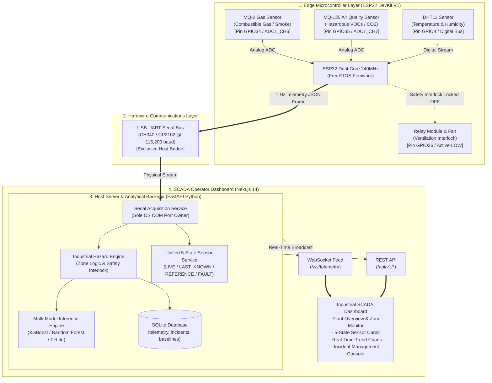

# ==============================================================================
# HazardWatch — System Architecture & Physical Interconnects
# ==============================================================================

This document provides system topology diagrams and hardware wiring specifications for HazardWatch.

---

## 1. End-to-End System Architecture



---

## 2. Hardware Pinout & Wiring Table

| Peripheral | Board Pin / Channel | ESP32 GPIO | Operating Voltage | Signal Type | Role in HazardWatch |
| :--- | :--- | :--- | :--- | :--- | :--- |
| **MQ-2** | Analog Out (AO) | `GPIO34` | 5.0 V VCC (Heater), 3.3 V ADC | Analog (0–3.3V) | Indicative combustible gas & smoke response |
| **MQ-135** | Analog Out (AO) | `GPIO35` | 5.0 V VCC (Heater), 3.3 V ADC | Analog (0–3.3V) | Indicative air contaminants & VOC response |
| **DHT11** | Data (OUT) | `GPIO4` | 3.3 V VCC | 1-Wire Digital Bus | Ambient climatic temperature & humidity |
| **Relay** | Control (IN) | `GPIO26` | 5.0 V VCC, 3.3 V Logic | Active-LOW Digital | Ventilation interlock (Held HIGH / Safe-OFF) |
| **Status LED**| Onboard LED | `GPIO2` | 3.3 V | Digital Output | Acquisition heartbeat (toggles on valid sample) |
| **UART TX** | TX0 | `GPIO1` | 3.3 V Logic | Serial (115200 baud)| Downlink telemetry transmission to host PC |
| **UART RX** | RX0 | `GPIO3` | 3.3 V Logic | Serial (115200 baud)| Uplink command link from host PC |

---

## 3. Physical Safety Interlock Topology

```
                  +--------------------------------+
                  |      ESP32 DevKit V1 Boot      |
                  +---------------+----------------+
                                  |
                                  v
                  +--------------------------------+
                  |  GPIO26 Mode: OUTPUT           |
                  |  GPIO26 State: HIGH (Safe-OFF) |
                  +---------------+----------------+
                                  |
                                  v
                  +--------------------------------+
                  | Any Sensor Missing or Faulted? |
                  +-------+----------------+-------+
                          |                |
                     YES  |                |  NO
                          v                v
      +-----------------------------+    +-----------------------------+
      | FORCE RELAY COMMAND = OFF   |    | Normal Monitoring State     |
      | State remains DISABLED      |    | Manual Control Permitted    |
      | Pump strictly powered down  |    | Continuous Safety Checks    |
      +-----------------------------+    +-----------------------------+
```
