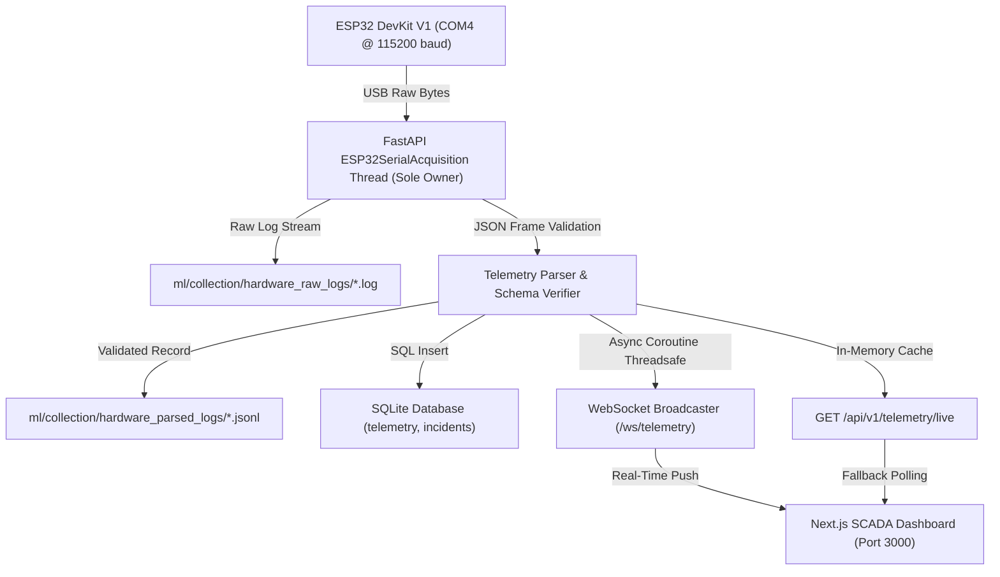

# Project_A1 — Milestone 5.3: Serial Ownership & Pipeline Architecture Report

**Date:** 2026-11-11  
**Architecture:** Single-Process Host Serial Ownership (FastAPI Broker Model)

---

## 1. Single Serial Reader Architecture



---

## 2. Verification Evidence from Live Stream

### Serial Status Endpoint (`GET /api/v1/serial/status`)
```json
{
  "connected": true,
  "port": "COM4",
  "baud_rate": 115200,
  "last_frame_timestamp": 1794380540.659,
  "last_error": null,
  "frames_received": 89,
  "status": "CONNECTED",
  "raw_log_path": "C:\\Users\\Administrator\\Videos\\Project_A1\\ml\\collection\\hardware_raw_logs\\ACQ_1794380533_raw.log",
  "parsed_log_path": "C:\\Users\\Administrator\\Videos\\Project_A1\\ml\\collection\\hardware_parsed_logs\\ACQ_1794380533_telemetry.jsonl"
}
```

### Live Hardware Telemetry Frame (`GET /api/v1/telemetry/live`)
```json
{
  "status": "LIVE",
  "source": "ESP32_HARDWARE",
  "data": {
    "device_id": "PROJECT_A1_ESP32_01",
    "mode": "BACKUP",
    "provenance": "PHYSICAL_ESP32",
    "timestamp_ms": 29517,
    "sensors": {
      "mq2_adc": 717,
      "mq135_adc": null,
      "temperature_c": null,
      "humidity_percent": null
    },
    "monitoring_state": "SENSOR_FAULT",
    "hazard_state": "SENSOR_FAULT",
    "inference": {
      "engine": "RULE_ENGINE",
      "status": "SENSOR_FAULT",
      "class": "UNKNOWN",
      "confidence": null
    },
    "relay": {
      "command": "DISABLED",
      "feedback": "UNAVAILABLE"
    },
    "host_reception_timestamp": 1794380563311,
    "session_id": "ACQ_1794380533"
  }
}
```

### Database Persistence Record (`GET /api/v1/telemetry?limit=1`)
```json
{
  "count": 1,
  "records": [
    {
      "id": 89,
      "event_id": "EVT-HW-1794380567312",
      "timestamp": 1794380567312,
      "operating_mode": "LIVE_HARDWARE",
      "provenance": "PHYSICAL_ESP32",
      "zone_id": "Z03",
      "device_id": "PROJECT_A1_ESP32_01",
      "mq2_adc": 695.0,
      "mq135_adc": null,
      "temperature": null,
      "humidity": null,
      "mq2_baseline": 338.0,
      "mq135_baseline": 1523.0,
      "server_prediction": "UNKNOWN",
      "edge_prediction": "UNKNOWN",
      "confidence": null,
      "is_ood": 0,
      "severity": "WARNING",
      "relay_command": 0,
      "actual_relay_state": 0,
      "fault_detected": 1,
      "created_at": "2026-11-11 07:02:47"
    }
  ]
}
```

---

## 3. Disconnection & Lifecycle Handling

1. **Backend Disconnect:** When `POST /api/v1/serial/disconnect` is requested, `active_serial.stop()` safely closes the serial handle, flushes buffers, and writes the SHA-256 acquisition manifest.
2. **Server Shutdown:** Registered in `@app.on_event("shutdown")` to guarantee `COM4` is released cleanly when `uvicorn` terminates.
3. **Reconnect Resilience:** If the USB cable is unplugged, `_read_loop()` catches `SerialException`, sets `last_error`, and logs errors without crashing the FastAPI event loop.
