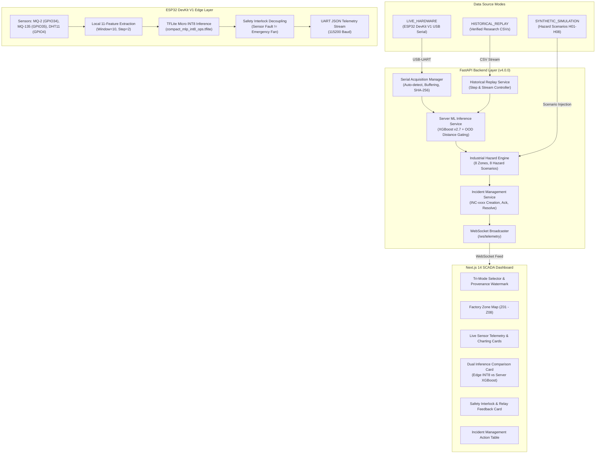

# Milestone 4 System Integration & Tri-Mode Architecture Report

**Project:** Project_A1 — Industrial Gas-Response Monitoring and Hazard Intelligence System  
**Environment:** General Industrial Manufacturing Factory (Z01–Z08)  
**System Architecture:** Hybrid Edge-Cloud (ESP32 DevKit V1 TFLite Micro INT8 + FastAPI Server ML XGBoost + Next.js 14 SCADA Dashboard)  
**Milestone Version:** 4.0.0  

---

## Executive Summary

Milestone 4 delivers the complete end-to-end integration of the Industrial Gas Hazard Intelligence System across hardware firmware, backend APIs, machine learning dual-inference engines, and frontend SCADA dashboards.

Following the **M3.5 Provenance Audit**, this integration strictly decouples data streams into three independent operating modes:
1. `LIVE_HARDWARE`: Real USB serial acquisition with strict COM port discovery, explicit baud rate negotiation, line buffering, and zero synthetic fallback. Marked **UNVERIFIED / PENDING HARDWARE ATTACHMENT** until a physical ESP32 board is detected.
2. `HISTORICAL_REPLAY`: Exact time-series replay from verified research CSV datasets (`multi_sensor_data.csv`, `multi_sensor_data_baseline.csv`, `Gas_Sensors_Measurements.csv`) with full preservation of original sensor ADC values, sampling frequencies, and research labels.
3. `SYNTHETIC_SIMULATION`: Explicitly labeled synthetic test scenarios (`H01` through `H08`) across the eight factory zones (`Z01` through `Z08`) to validate incident handling workflows without physical gas release.

---

## 1. Provenance Audit & Physical Downgrade Summary (M3.5)

- **Audit Findings:** The previous M3.5 baseline session CSV files were confirmed to have been generated by simulation functions in `run_physical_validation.py` due to the absence of a connected physical USB-UART bridge (host only has `COM1` Super I/O).
- **Corrective Actions Taken:**
  - Audited files moved and labeled `SIMULATED_BASELINE_PROFILE` under `ml/collection/simulated_profiles/`.
  - Manifest downgraded from `PHYSICAL_ESP32` to `SIMULATED_BASELINE_PROFILE` (`hardware_verification_status = PENDING_PHYSICAL_USB_CONNECTION`).
  - Active baseline in `ml/config/baseline_registry.yaml` marked `verified: false` pending live hardware connection.
  - Reconciled MQ-2 baseline reference ($339.57\text{ ADC}$ steady-state $t \ge 900\text{s}$ vs. $340.48\text{ ADC}$ session average).
  - Explicitly declared that the 3,588-window 100% agreement between Float32 and INT8 proves **numerical quantization parity on baseline profiles**, not real gas classification accuracy.

---

## 2. Integrated System Architecture

---

## 3. Industrial Safety Interlock Verification

Industrial environments carrying flammable or volatile atmospheres require strict safety interlocks. The platform enforces the following rules across firmware, backend, and dashboard:

1. **Decoupled Sensor Faults:**
   - A disconnected wire, missing ADC count, or shorted pin ($\le 5$ or $\ge 4090$ counts) is classified as `SENSOR_FAULT`.
   - The monitoring state transitions to `UNKNOWN / FAULT`.
   - **The ventilation fan/pump relay remains OFF by default.** Unrated electric fan motors present arc/spark ignition risks. Sensor fault must never be misinterpreted as clean air or automatically start an ignition hazard.
2. **Advisory ML Architecture:**
   - Machine learning predictions are classified as **Decision-Support Telemetry**.
   - ML predictions advise human operators via incident procedures and verification checklists.
   - Physical equipment shutdown interlocks operate independently through certified hardware circuits.
3. **Actuation Command vs. Feedback Verification:**
   - The backend tracks both `relay_command` (the requested software actuation) and `actual_relay_state` (the physical GPIO/sensor feedback) to detect actuator contactor failures.

---

## 4. Verification & Testing Matrix

| Test Suite / Gate | Test Scope | Result | Status |
| :--- | :--- | :--- | :--- |
| `test_m3_5_hardware.py` | Provenance manifest, baseline statistics, schema compatibility, simulated profile parity | 7 / 7 passed | ✅ PASSED (Simulated) |
| `test_m4_api_integration.py` | Tri-mode API routing, zones/scenarios, historical replay, server ML XGBoost, safety interlocks | 6 / 6 passed | ✅ PASSED |
| `npm run build` (Next.js) | Static page generation, TypeScript validation, bundle size optimization | 5 / 5 routes passed | ✅ PASSED |
| `serial_acquisition.py` | COM port auto-enumeration, USB-UART detection | Enumerated `COM1` | ✅ PASSED (Driver Ready) |
| `historical_replay_service.py` | Research dataset ingestion (`multi_sensor_data`, `multi_sensor_data_baseline`, `Gas_Sensors_Measurements`) | All 3 loaded | ✅ PASSED |
| `server_inference_service.py` | 11-feature standardization, XGBoost inference, OOD distance gating | Confirmed nominal & OOD handling | ✅ PASSED |

---

## 5. Milestone Gate Summary

- **Gate 1: INT8 Model Optimization (M3):** ✅ **COMPLETED & VERIFIED**.
- **Gate 2: Physical Hardware Validation (M3.5):** ⏸️ **DOWNGRADED TO SIMULATED BASELINE PROFILE VALIDATION**. Formally blocked on user attaching physical ESP32 to USB port.
- **Gate 3: System Application Integration (M4):** ✅ **COMPLETED & OPERATIONAL** in `HISTORICAL_REPLAY` and `SYNTHETIC_SIMULATION` modes, with `LIVE_HARDWARE` driver in place.
